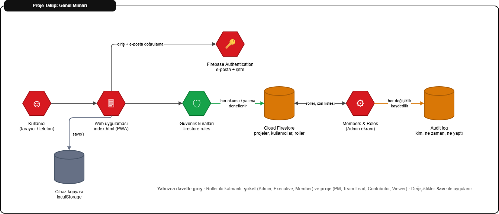
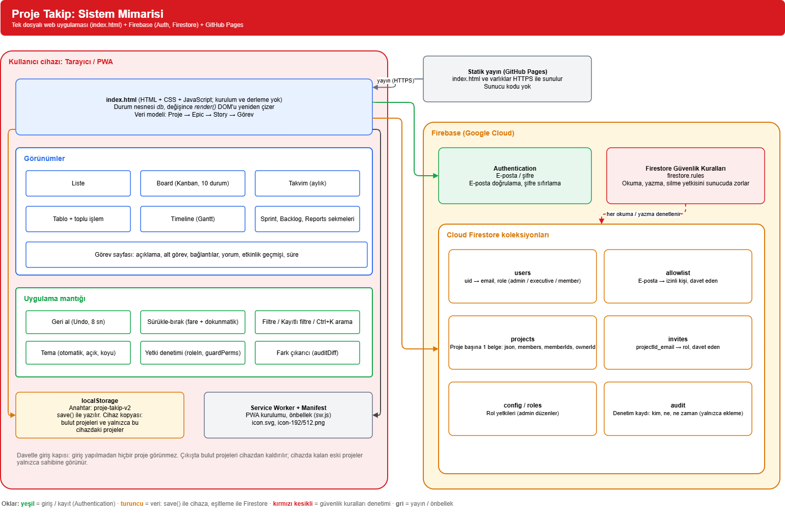
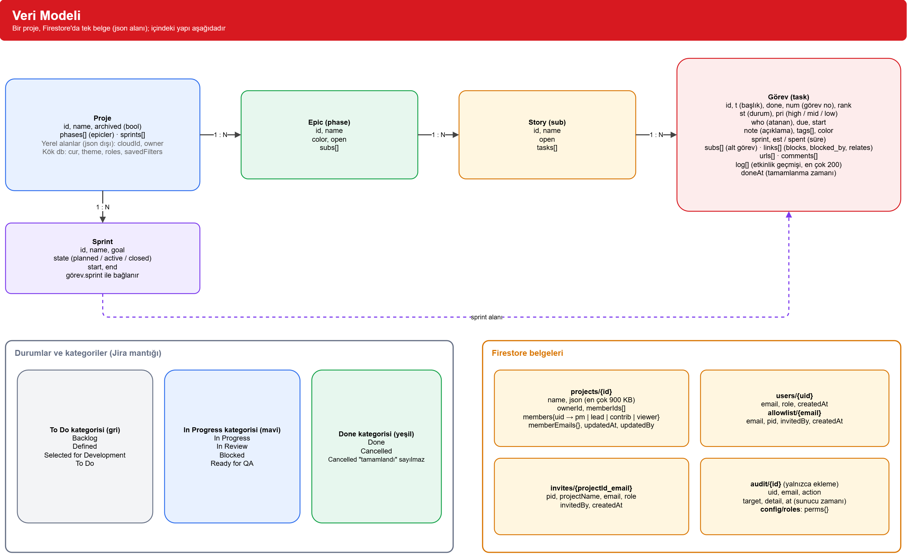
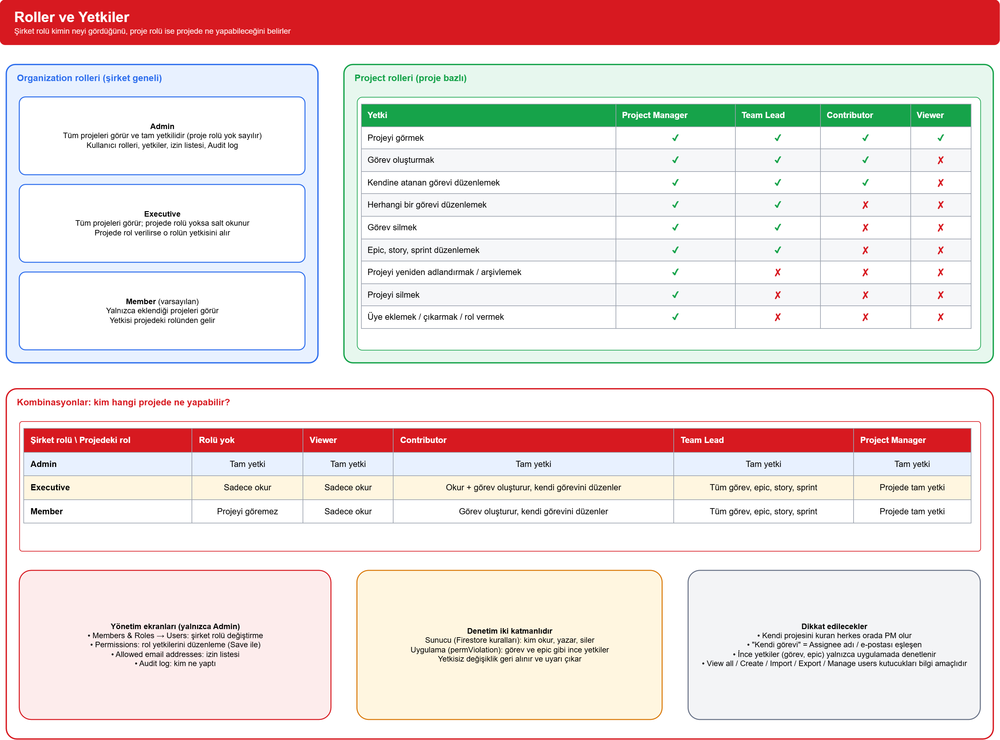
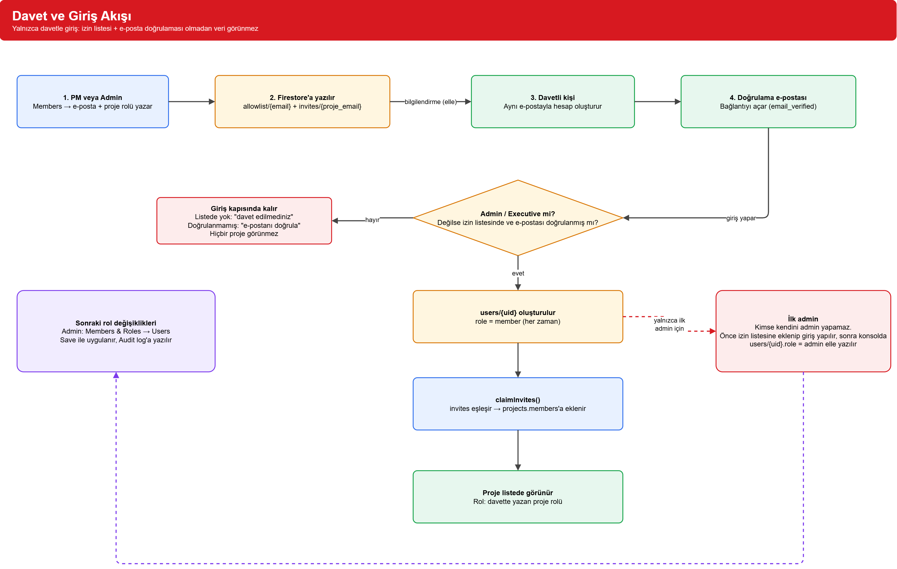
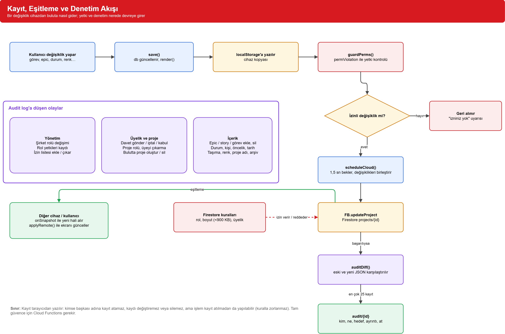

# Proje Takip

`index.html`, `css/` klasörü, `js/` klasörü ve `firebase.js` dosyalarından oluşan, derleme adımı gerektirmeyen bir proje ve görev takip aracı. Tarayıcıda açılır, PWA olarak kurulabilir. Giriş, bulut eşitleme, roller ve denetim kaydı için **Firebase** (Authentication + Firestore) kullanır. Uygulama arayüzü İngilizcedir.

Çalışma öğeleri **Epic → Story → Görev** hiyerarşisiyle planlanır; Jira mantığında durumlar, sprint, Board, Timeline ve raporlar vardır. Erişim **yalnızca davetle** verilir.

## İçindekiler
- [Hızlı kurulum](#hızlı-kurulum)
- [Özellikler](#özellikler)
- [Hesap, roller ve yetkiler](#hesap-roller-ve-yetkiler)
- [Denetim kaydı (Audit log)](#denetim-kaydı-audit-log)
- [Veri ve saklama](#veri-ve-saklama)
- [Güvenlik notları](#güvenlik-notları)
- [Diyagramlar](#diyagramlar)
- [Hazır şablonlar](#hazır-şablonlar)
- [Teknik notlar](#teknik-notlar)
- [Bilinen sınırlar](#bilinen-sınırlar)

## Hızlı kurulum

1. **Yayın:** Dosyalar statik olduğu için herhangi bir statik barındırma yeterlidir. GitHub Pages için: **Settings → Pages → Deploy from a branch → `main` / `(root)`**. Ücretsiz hesapta Pages için depo herkese açık olmalıdır. Adres: `https://KULLANICIADI.github.io/DEPOADI/`.
2. **Firebase projesi:** Firebase konsolunda proje açın, `firebase.js` içindeki Firebase yapılandırma değerlerini kendi projenizle değiştirin.
3. **Authentication:** Sign-in method → **Email/Password** açın. **Settings → Authorized domains** listesine yayın alan adınızı ekleyin (ör. `kullaniciadi.github.io`).
4. **Firestore:** Veritabanını oluşturun. `firestore.rules` dosyasının içeriğini **Firestore → Rules** bölümüne yapıştırıp **Publish** edin. Yayınlanmazsa veya test modu kalırsa giriş ekranı veriyi korumaz.
5. **İlk admin:** Kimse kendini admin yapamaz. Önce `allowlist` koleksiyonuna e-posta belgesi ekleyin (belge kimliği küçük harfli e-posta; alanlar: `email`, `invitedBy`, `createdAt`), uygulamada o adresle hesap açıp e-postayı doğrulayın ve bir kez giriş yapın. Sonra **Firestore → `users` → kendi UID'li belge → `role` = `admin`** yapın ve yeniden giriş yapın.
6. **API anahtarı kısıtlaması (önerilir):** Google Cloud Console → APIs & Services → Credentials → Browser key → *Websites* kısıtlaması olarak yayın adresinizi (`https://KULLANICIADI.github.io/*`) ekleyin.

Maliyet: Ücretsiz Spark planı küçük ekipler için yeterli olması beklenir, kredi kartı gerekmez. Kota dolarsa servis durur, ücret çıkmaz. Güncel limitler için [Firebase fiyatlandırma](https://firebase.google.com/pricing) sayfasına bakın.

## Özellikler

### Gezinme ve genel ekranlar
Sol kenar çubuğu: **Dashboard**, **For you**, **Archive**, **Members & Roles**, bildirimleri açma, **Import**, hesap (Sign in / hesap penceresi) ve tema düğmesi. Projeler kenar çubuğunda listelenir.
- **Dashboard:** proje kartları, özet, "Bu hafta ve geciken işler", durum/öncelik/kişi dağılımı ve haftalık tamamlanan iş.
- **For you:** Adınızı girin; Assignee alanı eşleşen işler tüm projelerden toplanır.
- **Arama:** Ctrl+K ile tüm projelerde görev arama.
- **Tema:** Otomatik (sistem) → Açık → Koyu, seçim saklanır.
- **Bildirimler:** Süresi gelmiş ve önceliği High (ya da `#urgent` / `#critical` / `#acil` / `#kritik` etiketli) işler için tarayıcı bildirimi; izin verilmezse sayfanın üstünde kırmızı kutuda görünür.

### Proje ekranı
Sekmeler: **Work items**, **Roadmap**, **Backlog**, **Sprints**, **Reports**.
- **Work items görünümleri:** List, Board, Calendar (aylık), Table, Timeline (Gantt).
- **Board:** Jira tarzı 10 durum; kartı sürükleyip sütuna bırakın ya da ◀ ▶ ile taşıyın; yeni görevler Backlog'da başlar; **Columns** ile sütun seçilir.
- **Filtreler:** durum, öncelik, etiket, kişi. Filtre isimle kaydedilebilir.
- **Table:** birden fazla görevi seçip durum, öncelik, sprint, kişi değiştirin ya da silin.
- **Sprints:** oluştur, başlat, tamamla (biten dışındakiler Backlog'a döner); yanmamış iş grafiği (burndown).
- **Reports:** duruma, önceliğe, kişiye göre dağılım, haftalık tamamlanan iş, geciken işler. Tamamlanma geçmişi bu özellikten sonra kaydedilir.
- **Sürükle-bırak:** Epic, story ve görevler sıralanır; görevler başka story'ye de taşınır. Dokunmatik ekranlarda tutamaçtan (⠿) sürüklenir.
- **Geri al:** Silinen görev, story, epic, proje ve arşivleme için 8 saniye "Undo" düğmesi (Ctrl+Z de çalışır). Silme onay sormaz.
- **Arşiv:** Biten projeler Dashboard'dan gizlenir; Archive bölümünden görülür ve geri alınır. Genel istatistiklere dahil edilmez.
- **Renkler:** Epic (🎨) ve görev (Colour alanı) renkleri değiştirilebilir. Durum ve öncelik renkleri sabittir.

### Görev sayfası
Görevin ✎ düğmesi tam sayfa açar: başlık, açıklama, alt görevler (checklist), bağlı görevler (blocks / is blocked by / relates to), bağlantılar (yalnızca `http(s)`), yorumlar, etkinlik geçmişi, başlangıç ve bitiş tarihi, tahmini ve harcanan süre, öncelik (High / Medium / Low), etiketler, atanan kişi, durum, sprint. Geciken görevler kırmızı görünür. Görev numaraları (`MOB-12`) sabittir; görev silinse de diğerleri değişmez.

### Durumlar ve renkleri (Jira mantığı)
Renk, durumun bağlı olduğu **kategoriden** gelir.
- **Gri (To Do kategorisi):** Backlog, Defined, Selected for Development, To Do
- **Mavi (In Progress kategorisi):** In Progress, In Review, Blocked, Ready for QA
- **Yeşil (Done kategorisi):** Done, Cancelled (iptal edilen iş "tamamlandı" sayılmaz, haftalık tamamlanma grafiğine girmez)

## Hesap, roller ve yetkiler

### Giriş (yalnızca davetle)
- Giriş yapılmadan hiçbir şey görünmez. İçeri yalnızca **Admin / Executive**'ler ve **izin listesindeki, e-postasını doğrulamış** kişiler girer.
- **Davet:** Projede **Members** → e-posta ve proje rolü yazıp davet edin. Kişi aynı e-postayla hesap açar, e-postasını doğrular, proje listesinde görünür. Bekleyen davetler Members penceresinde görünür ve iptal edilebilir.
- **İzin listesi:** Admin, Members & Roles → Users sekmesindeki **Allowed email addresses** bölümünden adres ekleyip çıkarır. Proje daveti de adresi otomatik ekler.
- Doğrulama e-postası hesap penceresinden ya da giriş kapısından tekrar gönderilebilir.
- Yeni kullanıcılar her zaman **Member** olarak oluşur. Şirket rolünü yalnızca Admin değiştirir.

### İki katmanlı rol modeli
- **Organization rolü** (kişi başına tek): kimin neyi gördüğünü ve yönetim ekranlarını belirler.
  - **Admin:** tüm projeleri görür ve tam yetkilidir (proje rolü yok sayılır). Kullanıcıları, rolleri, izin listesini ve Audit log'u yönetir.
  - **Executive:** tüm projeleri görür; projede rolü yoksa salt okunur.
  - **Member** (varsayılan): yalnızca eklendiği projeleri görür; yetkisi projedeki rolünden gelir.
- **Project rolü** (proje başına): o projede ne yapılabileceğini belirler.

| Yetki | Project Manager | Team Lead | Contributor | Viewer |
|---|:-:|:-:|:-:|:-:|
| Projeyi görmek | ✔ | ✔ | ✔ | ✔ |
| Görev oluşturmak | ✔ | ✔ | ✔ | ✘ |
| Kendisine atanmış görevi düzenlemek / durumunu değiştirmek | ✔ | ✔ | ✔ | ✘ |
| Herhangi bir görevi düzenlemek | ✔ | ✔ | ✘ | ✘ |
| Görev silmek | ✔ | ✔ | ✘ | ✘ |
| Epic, story, sprint düzenlemek | ✔ | ✔ | ✘ | ✘ |
| Projeyi yeniden adlandırmak / arşivlemek / silmek | ✔ | ✘ | ✘ | ✘ |
| Üye eklemek, çıkarmak, rol vermek, davet | ✔ | ✘ | ✘ | ✘ |

**Kombinasyonlar:**

| Şirket rolü \ Projedeki rol | Rolü yok | Viewer | Contributor | Team Lead | Project Manager |
|---|---|---|---|---|---|
| **Admin** | Tam yetki | Tam yetki | Tam yetki | Tam yetki | Tam yetki |
| **Executive** | Sadece okur | Sadece okur | Okur + görev oluşturur, kendi görevini düzenler | Tüm görev, epic, story, sprint | Projede tam yetki |
| **Member** | Projeyi göremez | Sadece okur | Görev oluşturur, kendi görevini düzenler | Tüm görev, epic, story, sprint | Projede tam yetki |

Notlar:
- Projeyi kuran kişi o projede otomatik Project Manager olur.
- "Kendi görevi", Assignee alanı kişinin adı, e-postası ya da e-postasının @ öncesiyle eşleşen görevdir (adı **For you** bölümünden girin).
- Permissions sekmesindeki *View all projects, Create projects, Import projects, Export projects, Manage users and roles* kutucukları bilgi amaçlıdır; uygulamada ayrıca denetlenmez.

### Members & Roles ekranı (Admin)
- **Permissions:** Bir rol seçilip yetkileri işaretlenir. Admin rolü kilitlidir. Yetkiler herkes için ortaktır (Firestore `config/roles`).
- **Users:** Tüm kullanıcılar tek tabloda; yeni rol seçilir.
- **Audit log:** Aşağıya bakın.
- Kendi şirket rolünüzü değiştiremezsiniz.

### Save düğmeleri
Rol ve yetki değişiklikleri **Save'e basılana kadar uygulanmaz**:
- Members & Roles → Permissions ve Users: üstte "N unsaved change" şeridi, **Save** ve **Discard**.
- Proje → Members penceresi: üye rolü değişiklikleri ve çıkarmalar Save ile uygulanır (× satırı soluklaştırır, ↶ geri alır). Davet gönderme ve iptal anında olur.
- Kayıt başarısız olursa hangi işlemin neden reddedildiği gösterilir.

### Yetki uygulaması
- **Sunucu (Firestore kuralları):** kim okur, yazar, siler, üye ekler.
- **Uygulama:** ince yetkiler (görev oluştur/sil/düzenle, epic düzenle). Yetkisiz değişiklik geri alınır ve uyarı çıkar.
- Salt okunur rollerde (Viewer, rolsüz Executive) alanlar pasif gelir, sürükleme kapanır, üstte "View only" uyarısı çıkar.

## Denetim kaydı (Audit log)

**Members & Roles → Audit log** (yalnızca Admin, son 300 kayıt). Kaydedilenler:
- Şirket rolü değişimi, rol yetkilerinin kaydı, izin listesine ekleme/çıkarma
- Davet gönderme, iptal, kabul; proje rolü değişimi; üyeyi çıkarma
- Bulutta proje oluşturma ve silme
- Epic, story ve görev ekleme/silme/yeniden adlandırma/taşıma; durum, atanan kişi, öncelik, tarih, sprint ve renk değişiklikleri; proje adı ve arşiv

Çalışma biçimi: proje buluta kaydedilince eski ve yeni hâl karşılaştırılır, farklar `audit` koleksiyonuna yazılır (bir kayıtta en çok 25 kayıt). Kurallar kayıt eklenmesine yalnızca kişinin kendi adına ve sunucu zamanıyla izin verir; **kayıt düzenlenemez ve silinemez**, yalnızca Admin okur.

Sınır: Kayıt tarayıcıdan yazıldığı için bir işlemin kayıt atılmadan yapılması kuralla engellenemez. Tam güvence için sunucu tarafı (Cloud Functions, ücretli Blaze planı) gerekir. Giriş/çıkış olayları kaydedilmez. Görev sayfasındaki *etkinlik geçmişi* ise proje belgesinin içindedir ve denetim kaydı yerine geçmez.

## Veri ve saklama
- **Bulut:** Giriş yapılınca projeler Firestore'da saklanır ve cihazlar arasında eşitlenir (`projects/{id}`: tek belge, `json` alanı en çok 900 KB). Değişiklikler yaklaşık 1,5 sn sonra buluta gider.
- **Cihaz:** `localStorage` (anahtar `proje-takip-v2`) cihaz kopyasını tutar. Çıkışta bulut projeleri cihazdan kaldırılır; cihazda kalan eski projeler yalnızca sahibine (sahipsizler yalnızca Admin'e) görünür.
- **Yükleme:** Cihazdaki projeler otomatik yüklenmez; hesap penceresindeki **Upload** ile (önce yerel yedek alınır) buluta taşınır.
- **Yedek / aktarım:** Projedeki **Export** JSON'u kopyalanacak bir pencerede gösterir; kenar çubuğundaki **Import** JSON'dan proje ekler. Eski biçimler (`asamalar`, `altbasliklar`, `gorevler`) okunur.
- Rol yetkileri `config/roles`, kullanıcılar `users`, izin listesi `allowlist`, davetler `invites`, denetim kaydı `audit` koleksiyonlarındadır.

## Güvenlik notları
- `firebaseConfig` (apiKey dahil) herkese açık bilgidir; erişimi **Authentication ve Firestore kuralları** korur. En kritik adım, `firestore.rules` dosyasının konsolda **yayınlanmış** olmasıdır. Rules Playground'da girişsiz bir okuma "Denied" vermelidir.
- API anahtarını yayın alan adına kısıtlamak ek bir katmandır (bkz. kurulum 6).
- Kodda `innerHTML` yalnızca sabit ikonlar ve sayısal grafik için kullanılır; kullanıcı metinleri `textContent` ile yazılır. Bağlantılar yalnızca `http(s)` kabul eder.
- Herkese açık kayıt kapatılabilir (Authentication → Settings → User actions), ancak davet akışı kişinin kendi hesabını açmasına dayandığı için kapatırsanız davetlilerin hesaplarını konsoldan elle açmanız gerekir. Kurallar davetsiz kişiye zaten veri vermez.

## Diyagramlar

[`proje-diyagrami.drawio`](proje-diyagrami.drawio) dosyası [diagrams.net](https://app.diagrams.net) (draw.io) ile açılır (**Open Existing Diagram**, ya da dosyayı sayfaya sürükleyin). PNG/PDF için **File → Export as**. Altı sayfa içerir:

- **Genel Bakış (ilk sayfa):** projeyi tek bakışta anlatan sade şema: kullanıcı → web uygulaması → güvenlik kuralları → Firestore, Authentication, yönetici ekranı, Audit log ve cihaz kopyası.

1. **Sistem Mimarisi:** tarayıcı/PWA, cihaz kopyası (localStorage), Firebase (Authentication, Firestore, güvenlik kuralları) ve statik yayın.
2. **Veri Modeli:** Proje → Epic → Story → Görev alanları, Sprint ilişkisi, durum kategorileri ve Firestore belgeleri.
3. **Roller ve Yetkiler:** Organization rolleri, proje rollerinin yetki tablosu ve şirket rolü × proje rolü kombinasyonları.
4. **Davet ve Giriş Akışı:** davetten projenin listede görünmesine kadar adımlar, izin listesi ve e-posta doğrulaması, ilk admin.
5. **Kayıt ve Denetim Akışı:** değişikliğin yetki kontrolünden buluta ve Audit log'a gidişi.

### Genel bakış

### Sistem mimarisi (sayfa 1)

### Veri modeli (sayfa 2)

### Roller ve yetkiler (sayfa 3)

### Davet ve giriş akışı (sayfa 4)

### Kayıt, eşitleme ve denetim akışı (sayfa 5)

Her diyagramın tek sayfalık kaynak dosyası `docs/` klasöründedir: `veri-modeli-diyagram.drawio`, `roller-diyagram.drawio`, `davet-akisi-diyagram.drawio`, `kayit-denetim-diyagram.drawio`.

Kod veya Firestore kuralları değiştiğinde diyagramın ve `docs/` altındaki görsellerin de güncellenmesi gerekir (diagrams.net'te **File → Export as → PNG**, zoom 200%).

## Hazır şablonlar
Mobil Oyun, Mobil Uygulama, Web Sitesi / Web Uygulaması, Yazılım Ürünü (MVP), Kurumsal Proje Yönetimi, Pazarlama Kampanyası, Finans: Ajan Destekli Piyasa Analizi ve İşlem.

Finans şablonu 7 aşamadan oluşur: hedef ve çerçeve → ajan/skill altyapısı → veri kaynakları → piyasa analizi (ABD hisse, kripto, merdiven işlemler) → strateji ve test (geriye dönük + kâğıt üzerinde) → canlı işlem ve takip → operasyon ve iyileştirme. Yatırım tavsiyesi değildir; yalnızca bir iş planı iskeletidir.

## Teknik notlar
- **Dosyalar:** `index.html` (sayfa iskeleti), `css/` klasörü (stiller, konuya göre bölünmüş), `js/` klasörü (uygulama mantığı, konuya göre bölünmüş betikler: `data.js`, `cloud.js`, `board.js`, `task.js`, `timeline.js`, `sprints.js`, `reports.js` vb.), `firebase.js` (Firebase girişi ve bulut eşitleme), `firestore.rules`, `manifest.webmanifest`, `sw.js` (önbellek, bildirimler), `logo.svg`, `icon.svg`, `icon-192.png`, `icon-512.png`, `proje-diyagrami.drawio`.
- **Bağımlılık:** Yalnızca Firebase JavaScript SDK'sı (`gstatic.com` üzerinden, sabit sürüm). Başka kütüphane ve derleme adımı yoktur.
- **Veri modeli (özet):** `{ cur, theme, roles, savedFilters, projects: [{ id, name, archived, phases: [{ id, name, color, open, subs: [{ id, name, open, tasks: [Task] }] }], sprints: [{ id, name, goal, start, end, state }] }] }`
  - `Task`: `id, t, done, st, pri, who, due, start, note, tags, color, sprint, est, spent, num, rank, subs, comments, log, links, urls, doneAt`
  - Durum (`st`): `backlog, defined, selected, todo, doing, review, blocked, qa, cancelled` (`done` ayrı alan). Öncelik: `high | mid | low`. Sprint durumu: `planned | active | closed`.
- **Sürükle-bırak:** fare için HTML5 Drag and Drop, dokunmatik/kalem için pointer olayları.
- **Ad sorma:** `prompt()` yerine sayfa içi pencere kullanılır (bazı önizleme ortamları `prompt()` çağrısını engeller).
- **Tema:** CSS değişkenleri; `prefers-color-scheme` ve elle seçim.

## Bilinen sınırlar
- İnce yetkiler (görev, epic düzenleme) uygulamada denetlenir; sunucu yalnızca kaba ayrımı (okuma / yazma / silme) zorlar. Çok güvenilmeyen kullanıcılar için yetersizdir.
- Bir proje tek Firestore belgesidir (en çok ~900 KB). İki kişi aynı anda düzenlerse son kaydeden diğerinin değişikliğinin üzerine yazabilir.
- Denetim kaydı kuralla zorlanmaz (bkz. yukarıda); SSO, 2FA, e-posta/Slack bildirimi, API ve webhook yoktur.
- Geri al yalnızca tarayıcıda 8 saniye geçerlidir; bulut yedeği otomatik değildir.
- Dokunmatik sürükleme gerçek cihazda test edilmedi.
